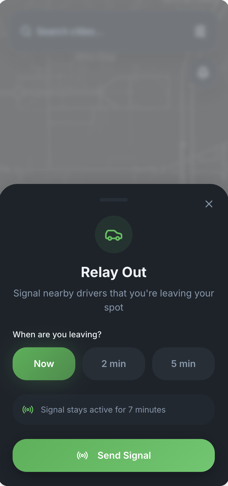

# ParkRelay : étude de cas d’une application de stationnement à Ottawa

**Mon rôle : cadrage produit, UX/UI, livraison technique et coordination du lancement.** ParkRelay relie les conducteurs qui quittent une place de stationnement dans la rue à ceux qui en cherchent une à proximité. J’ai travaillé sur la première version à Ottawa et porté trois décisions de produit : commencer par le stationnement gratuit, concevoir « Relay Out » et limiter la durée de chaque signalement.

La première semaine, le projet a enregistré **167 comptes inscrits et 246 signalements de places**. J’ai confirmé ces chiffres pour cette étude de cas. Ils ne disent pas combien de conducteurs ont effectivement trouvé une place.

Ce texte présente ma contribution à un projet client. Il ne s’agit pas du dépôt officiel de ParkRelay ; le code de l’application et ses données analytiques internes n’y figurent pas.

## Le problème

Un conducteur qui quitte une place possède une information utile pendant quelques minutes. Le conducteur qui cherche à se garer à proximité ne la voit pas. ParkRelay transforme cette information éphémère en signal sur une carte.

Le produit sert deux personnes aux besoins différents. Celle qui part doit pouvoir signaler la place sans s’arrêter longtemps. Celle qui cherche a besoin d’un signal récent, proche et compréhensible. Le signal ne peut pas réserver une place publique : un autre véhicule peut arriver avant elle.

## Ce que fait la première version

Le premier périmètre couvre le **stationnement gratuit dans la rue à Ottawa**. Le conducteur sortant utilise **Relay Out**. Les conducteurs proches consultent les signaux sur une carte, ajustent leur rayon de recherche et peuvent lancer la navigation. Le produit public décrit aussi des notifications. Il ne garantit pas qu’une place sera encore libre à l’arrivée. [Site ParkRelay](https://parkrelay.ca/) · [App Store](https://apps.apple.com/us/app/parkrelay-find-parking-fast/id6760568658) · [Google Play](https://play.google.com/store/apps/details?id=com.partrelay.app)

L’écran Relay Out propose **Now, 2 min ou 5 min**. Avec **Now** sélectionné, il indique qu’un signal reste actif **7 minutes**, puis demande d’appuyer sur **Send Signal**. La capture établit ce qui est affiché à l’utilisateur ; elle ne démontre pas à elle seule la règle côté serveur.

*Capture fournie par Mohamed DE pour cette étude de cas, avec autorisation d’utilisation sur GitHub et le portfolio.*

## Ma contribution

J’ai travaillé sur le cadrage, l’UX/UI, l’authentification, la géolocalisation, les signalements en direct, les notifications et les tests. J’ai aussi coordonné le lancement à Ottawa et le suivi des versions mobiles. Ce périmètre est décrit sur mon [portfolio](https://mohamedde.lovable.app/en/work/parkrelay) et mon [profil GitHub](https://github.com/MohamedDz07/MohamedDz07/blob/main/README.md). Le projet a été livré en équipe ; cette liste ne signifie pas que j’ai développé seul chaque composant.

Mon portfolio cite **Supabase, Mapbox et Capacitor** parmi les technologies du projet. Le code client n’étant pas public ici, je ne détaille pas une architecture que le lecteur ne pourrait pas vérifier.

## Trois décisions que j’ai prises

### 1. Commencer par le gratuit ; reporter le swap payant

J’ai limité le MVP aux places gratuites dans la rue et repoussé le **swap payant** à une V2 envisagée. La première version pouvait ainsi se concentrer sur le partage et l’utilisation de signaux récents, sans ajouter le paiement au parcours initial. Cette étude ne décrit pas les modalités ni la date de la V2.

### 2. Donner une action claire au conducteur qui part

J’ai conçu **Relay Out** pour le moment où un conducteur quitte sa place. L’écran lui donne trois choix de départ — Now, 2 min ou 5 min — avant l’envoi du signal. L’action reste visible sans présenter le signal comme une réservation.

### 3. Faire expirer les signaux

J’ai défini une durée de validité pour Relay Out. Plus un signal vieillit, moins il aide le conducteur en recherche ; laisser d’anciens signalements sur la carte risquerait de le tromper. La capture annonce **7 minutes** lorsque **Now** est sélectionné. Elle documente la règle affichée, sans vérifier l’expiration côté serveur.

Les [notes produit](docs/PRODUCT_ANALYSIS.md), en anglais, séparent ces décisions confirmées de l’analyse rétrospective.

## Lancement et lecture des résultats

ParkRelay dispose de fiches publiques sur [iOS](https://apps.apple.com/us/app/parkrelay-find-parking-fast/id6760568658) et [Android](https://play.google.com/store/apps/details?id=com.partrelay.app). Son site invite également à rejoindre le MVP. Ces sources ne permettent pas de dater le pilote d’Ottawa ni d’en établir le statut.

Les **167 inscriptions et 246 signalements de la première semaine** montrent une activité initiale. Ils ne mesurent ni le taux de stationnement réussi, ni le temps gagné, ni la fidélisation, ni les émissions évitées. Je n’utilise pas de « taux de réussite » sans définition et données sources. L’export analytique de cette semaine n’est pas joint.

La prochaine question utile est la qualité des signaux : étaient-ils **récents, proches et utiles** au moment où quelqu’un cherchait une place ? Je suivrais leur ancienneté, leur densité selon les lieux et les heures, la proportion de recherches avec un signal valide et les retours après navigation. Ce sont des mesures proposées, pas des résultats déjà obtenus.

## Ce que montre ce projet

La carte est l’interface visible. Les décisions produit portent sur le périmètre de la première version, la signification de Relay Out et le moment où l’information expire. Elles déterminent ce que ParkRelay peut annoncer aux conducteurs avec précision.

Pour un poste en produit technique ou en livraison, voici mon [portfolio](https://mohamedde.lovable.app/en) et mon [LinkedIn](https://www.linkedin.com/in/mohamed-de-1018a915b/). Pour discuter d’un produit mobile, vous pouvez [m’écrire](mailto:mohamedde@icloud.com).

**Sources :** [ParkRelay](https://parkrelay.ca/), [App Store](https://apps.apple.com/us/app/parkrelay-find-parking-fast/id6760568658), [Google Play](https://play.google.com/store/apps/details?id=com.partrelay.app), [étude de cas initiale](https://mohamedde.lovable.app/en/work/parkrelay). J’ai confirmé les chiffres et les trois décisions ci-dessus pour ce document le 17 novembre 2026. [Read in English](README.md).
