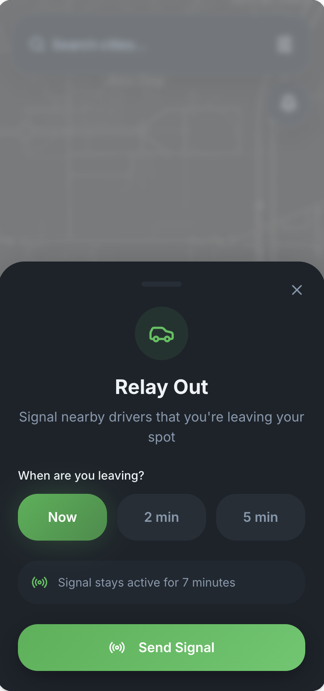

# ParkRelay product case study: a parking signal app for Ottawa

**My role: product scoping, UX/UI, technical delivery and launch coordination.** ParkRelay is a mobile app for drivers leaving a public street parking space and drivers looking for one nearby. I worked on the first version for Ottawa, including three product decisions that shaped its scope: start with free street parking, make “Relay Out” easy to use, and make each report expire.

In the first week, the project recorded **167 registered accounts and 246 parking reports**. I confirmed these launch figures for this case study.

This is my account of a client project, not the official ParkRelay repository. The app’s source code and internal analytics are not included.

## The problem

A driver pulling out of a street space knows something useful for a few minutes. A driver circling nearby cannot see it. ParkRelay turns that short-lived information into a signal on a map.

The product has two users with different needs. Reporting has to take little effort from the driver who is leaving. The driver searching needs a recent, nearby signal and an honest explanation of what it means. A report cannot reserve a public space; someone else may arrive first.

## What the first version does

The initial scope was **free public street parking in Ottawa**. A departing driver uses **Relay Out** to share an opportunity. Nearby drivers can see live signals, adjust the search radius and navigate toward an area. The public product also describes notifications. It does not promise an available space. [ParkRelay website](https://parkrelay.ca/) · [App Store](https://apps.apple.com/us/app/parkrelay-find-parking-fast/id6760568658) · [Google Play](https://play.google.com/store/apps/details?id=com.partrelay.app)

The Relay Out screen makes the time choice explicit: **Now, 2 min or 5 min**. With **Now** selected, it tells the driver the signal stays active for **7 minutes** before the driver taps **Send Signal**. This is what the supplied screen shows; it does not by itself verify the server-side expiry rule.

*Relay Out screen supplied by Mohamed DE for this case study, with permission to use it on GitHub and the portfolio.*

~~~mermaid
flowchart LR
    A[Driver leaves a space] --> B[Relay Out signal]
    B --> C[Signal appears nearby]
    C --> D[Searching driver checks the map]
    D --> E[Navigates to the area]
    E --> F[Checks for an available space]
~~~

## My contribution

I worked on product scoping, UX/UI, authentication, geolocation, live reports, notifications and testing, and coordinated the Ottawa launch and mobile releases. The [portfolio case study](https://mohamedde.lovable.app/en/work/parkrelay) and my [GitHub profile](https://github.com/MohamedDz07/MohamedDz07/blob/main/README.md) describe this scope. It was a team delivery; the list does not mean I wrote every component.

The portfolio names **Supabase, Mapbox and Capacitor** as the project stack. Because the client code is private, this case study does not make claims about the complete architecture or ownership of individual modules.

## Three decisions I made

### 1. Free parking first; paid swap later

I limited the MVP to free public street parking. A paid **swap** flow was left for a planned V2. That kept V1 focused on sharing and finding timely signals, with no payment flow in the initial journey.

### 2. Give the departing driver one clear action

I designed **Relay Out** around the moment a driver is leaving. The screen presents the departure time as three choices — Now, 2 min or 5 min — before the driver sends the report. It makes the action prominent without presenting the signal as a reservation.

### 3. Let signals expire

I defined a validity period for a Relay Out signal. A report becomes less useful as time passes; keeping old reports on the map would mislead searchers. The supplied screen communicates **7 minutes** when **Now** is selected. I am describing the displayed rule, not claiming to have independently tested backend expiry.

The [product notes](docs/PRODUCT_ANALYSIS.md) record the boundary between these decisions, the public product behaviour and my later analysis.

## Launch and what the numbers mean

ParkRelay has public listings on [iOS](https://apps.apple.com/us/app/parkrelay-find-parking-fast/id6760568658) and [Android](https://play.google.com/store/apps/details?id=com.partrelay.app). Its website also invites people to join the MVP. Neither source establishes the dates or status of an Ottawa pilot.

The first-week counts — **167 registrations and 246 parking reports** — show that people joined and contributed. They do not measure successful parking, time saved, retention or reduced emissions. The raw first-week analytics are not public in this repository.

The next useful question is whether a report was **recent, nearby and useful to a searcher**. I would look at signal age, density by area and time, the share of search sessions that encounter a valid report, and feedback after navigation. Those are proposed measures, not results from the launch.

## What this case shows

The map is the visible interface. The product decisions are the scope of the first release, the meaning of Relay Out, and the point at which its information expires. They shaped what ParkRelay could tell a driver with confidence.

If you are hiring for a technical product or delivery role, see my [portfolio](https://mohamedde.lovable.app/en) and [LinkedIn](https://www.linkedin.com/in/mohamed-de-1018a915b/). If you are building a mobile product, [contact me](mailto:mohamedde@icloud.com).

**Sources:** [ParkRelay](https://parkrelay.ca/), [App Store](https://apps.apple.com/us/app/parkrelay-find-parking-fast/id6760568658), [Google Play](https://play.google.com/store/apps/details?id=com.partrelay.app), [my original case study](https://mohamedde.lovable.app/en/work/parkrelay). The first-week counts and three decisions above were confirmed by me for this document on 17 November 2026. [Lire en français](CASE_STUDY_FR.md).
